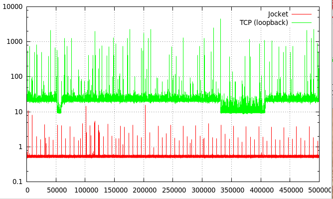

# Jocket

[](https://github.com/pcdv/jocket/actions/workflows/build.yml)

Jocket is a low-latency replacement for local Java sockets, based on shared
memory. Two processes on the same host exchange data through memory-mapped
files instead of the TCP stack, with a median round trip of about half a
microsecond.

- **Low latency**: 10 to 100 times lower than a TCP socket on the loopback
  interface (see [Performance](#performance)).
- **Familiar API**: `ServerJocket` and `JocketSocket` mimic `ServerSocket` and
  `Socket`, with standard input and output streams.
- **Non-blocking and zero-copy APIs** for the most demanding use cases.
- **Efficient waiting under Linux**: an idle reader sleeps on a
  [futex](https://en.wikipedia.org/wiki/Futex) and is woken up as soon as data
  is available.
- **Robust**: sockets can be closed from any thread, and each side detects the
  death of the other process.

## Requirements

- Java 21 or later.
- Linux, macOS or Windows. Linux is the reference platform:

| Platform               | Waiting for data                                                        |
|------------------------|-------------------------------------------------------------------------|
| Linux x86-64           | Futex, through a JNI library included in the jar                        |
| Linux, other platforms | Futex when built from source on that platform, otherwise as below       |
| macOS, Windows         | Spinning, then yielding, then sleeping for increasing durations        |

Without the futex, latency remains low while data flows, but a waiting thread
consumes more CPU and reacts more slowly after long idle periods.

## Installation

Jocket is available through [JitPack](https://jitpack.io/#pcdv/jocket).
With Gradle:

```groovy
repositories {
  maven { url 'https://jitpack.io' }
}

dependencies {
  implementation 'com.github.pcdv:jocket:<version>'
}
```

## Usage

### Sockets

```java
// server
try (ServerJocket server = new ServerJocket(4242);
     JocketSocket socket = server.accept()) {
  InputStream in = socket.getInputStream();
  OutputStream out = socket.getOutputStream();
  // ...
}

// client
try (JocketSocket socket = new JocketSocket(4242)) {
  InputStream in = socket.getInputStream();
  OutputStream out = socket.getOutputStream();
  // ...
}
```

Data written to the output stream becomes visible to the other side when
`flush()` is called.

### Low-level API

`JocketWriter` and `JocketReader` give direct, non-blocking access to a shared
buffer, which avoids the overhead of streams. They can also be used between
two threads of the same process:

```java
JocketFile file = new JocketFile(1024, 1 << 20); // max packets, data capacity
JocketWriter writer = file.writer();
JocketReader reader = file.reader();

int written = writer.write(data, 0, data.length); // 0 if the buffer is full
writer.flush();

int read = reader.read(buffer, 0, buffer.length); // 0 if no data is available
```

`JocketWriter.newPacket()` / `send()` and `JocketReader.nextPacket()` /
`release()` form an experimental zero-copy API, which exposes the shared
memory directly as `ByteBuffer`s.

## Performance



The chart shows the round-trip latency, in microseconds, between two
processes:

1. the client sends a 4-byte request (PING) to the server,
2. the client receives a 1024-byte response (PONG).

It was measured in 2017 on an Intel Core i5-2500 (4 cores, 3.30 GHz). In 2026,
the median round trip remains around 0.5 microseconds (under WSL2, on an Intel
Core Ultra 7 155H).

The benchmark can be run with `run-bench.sh`, after building:

```
$ ./run-bench.sh -Dreps=500000
Jocket listening on 3333
Warming up     :      50000 reps, pause between reps: 0ns... done in 114ms
Running test   :     500000 reps, pause between reps: 0ns... done in 279ms
Dumping results in /tmp/Jocket
1.0%          ( 495000) :     0,50 (us)
10.0%         ( 450000) :     0,52 (us)
50.0%         ( 250000) :     0,53 (us)
99.0%         (   5000) :     0,57 (us)
99.9%         (    500) :     0,60 (us)
99.99%        (     51) :     1,97 (us)
99.999%       (      6) :     5,43 (us)
99.9999%      (      1) :    15,57 (us)

$ ./run-bench.sh -Dreps=500000 -Dtcp=true
Java ServerSocket listening on 3333
Warming up     :      50000 reps, pause between reps: 0ns... done in 737ms
Running test   :     500000 reps, pause between reps: 0ns... done in 9597ms
Dumping results in /tmp/Socket
1.0%          ( 495000) :     9,42 (us)
10.0%         ( 450000) :     9,79 (us)
50.0%         ( 250000) :    20,62 (us)
99.0%         (   5000) :    22,05 (us)
99.9%         (    500) :    32,69 (us)
99.99%        (     51) :   509,07 (us)
99.999%       (      6) :  2128,08 (us)
99.9999%      (      1) :  4546,98 (us)
```

| Option             | Description                                          | Default  |
|--------------------|------------------------------------------------------|----------|
| `-Dtcp=true`       | Uses a TCP socket instead of Jocket                  | `false`  |
| `-Dreps=N`         | Number of repetitions                                | `300000` |
| `-Dwarmup=N`       | Number of repetitions during warmup                  | `50000`  |
| `-Dpause=N`        | Pause between repetitions, in nanoseconds            | `0`      |
| `-DreplySize=N`    | Size of the response, in bytes                       | `1024`   |
| `-Dport=N`         | TCP port                                             | `3333`   |
| `-Dnostats=true`   | Does not record latencies (for large numbers of repetitions) | `false`  |

The client writes the latencies to a file named `Jocket` or `Socket` in the
temporary directory, which can be plotted, e.g. with gnuplot:

```
plot '/tmp/Jocket' using 1 with lines title 'Jocket', '/tmp/Socket' using 1 with lines title 'TCP (loopback)'
```

## How it works

Each direction of a socket uses a shared buffer, backed by a memory-mapped
file, with one writer and one reader.

`JocketWriter.write()` appends data to the buffer, and `JocketWriter.flush()`
publishes it as a packet, which `JocketReader.read()` can read immediately.
The buffer is bounded both by a maximum number of packets and by a maximum
number of bytes written but not read yet. When either limit is reached,
`write()` returns 0 until the reader has read some data.

A `JocketSocket` connects to a `ServerJocket` through a TCP socket bound to the
loopback interface. The server sends the paths of the two exchange files,
which the client opens; both sides then delete the files, which remain mapped.
This connection is only used for this handshake.

### Closing and failures

- `close()` can be called from any thread, e.g. to wake up a thread blocked on
  a read. It waits for the read or write in progress, if any, before unmapping
  the exchange file. A shutdown hook closes the sockets that remain open.
- When the writer closes, the reader first receives all the data flushed
  before, then the end of stream.
- When one side cannot progress (no data to read, or no space to write), it
  checks at most once per second that the other process is still alive. If it
  died without closing (e.g. killed with SIGKILL), the reader receives the end
  of stream, and the writer a `ClosedException`. This check is disabled when
  the two processes run in different PID namespaces, e.g. two containers
  sharing `/dev/shm`.

### Security

- Exchange files have random names and are only accessible to their owner:
  the client must run as the same user as the server.
- The client only opens regular files of the exchange directory, named like
  the files created by servers, and does not follow symbolic links.
- Like a TCP server bound to the loopback interface, a `ServerJocket` accepts
  connections from any local process.

## Configuration

The following system properties are supported:

| Property                  | Description                                                                                                      | Default                                               |
|---------------------------|------------------------------------------------------------------------------------------------------------------|-------------------------------------------------------|
| `jocket.dir`              | Directory of the exchange files. Must be the same for the server and its clients.                                | `/dev/shm` (memory only) under Linux, `java.io.tmpdir` elsewhere |
| `jocket.maxPackets`       | Maximum number of packets in the buffers created by a `ServerJocket` (a power of 2)                              | `1024`                                                |
| `jocket.capacity`         | Data capacity, in bytes, of the buffers created by a `ServerJocket` (a power of 2)                               | `4194304` (4 MB)                                      |
| `jocket.peerCheckMillis`  | Minimum time between two checks that the other process is alive, in milliseconds                                | `1000`                                                |

## Building

```
git clone https://github.com/pcdv/jocket.git
cd jocket
./gradlew build
```

Gradle uses a locally installed JDK 21, or downloads one if none is found.
Under Linux, the build also compiles the JNI futex library with `gcc`, for the
architecture of the build machine only.

## Changelog

### 1.0.0

- Requires Java 21.
- The layout of exchange files and the handshake have changed: version 1.0.0
  cannot connect to earlier versions.
- Shared memory is accessed with the required ordering guarantees (acquire /
  release, through VarHandles), including on ARM, e.g. Apple Silicon.
- Fixed JVM crashes when a socket was used or closed concurrently, or used
  after being closed, and data loss or corruption in several corner cases.
- Detection of dead peers, and progressive backoff when waiting without a
  futex.
- Hardened handshake: `accept()` survives failing clients, exchange files are
  private, and clients check the paths they receive.

## License

Jocket is released under the [Apache License 2.0](LICENSE).
